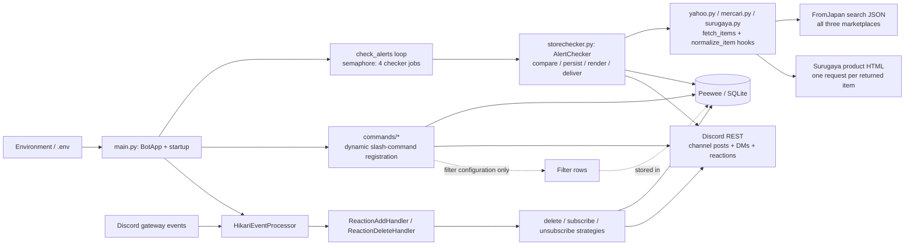
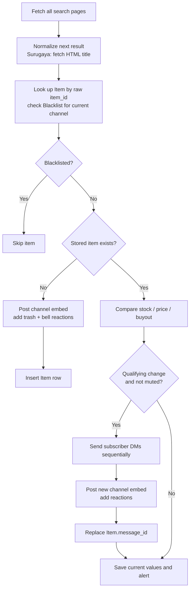
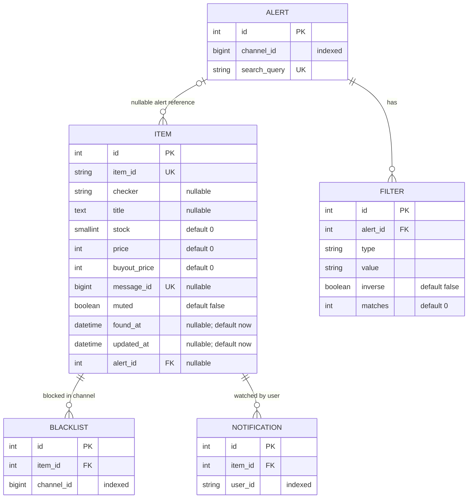
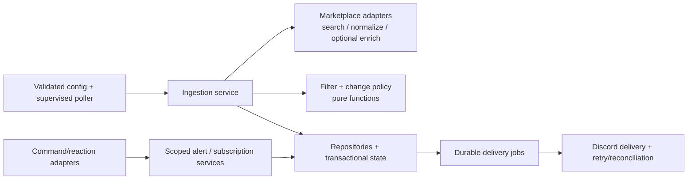

# Current architecture and rewrite reference

Snapshot: commit `772b55902dc6658cae20c7c13b42370d42407437`, reviewed on 2026-10-03. This document describes the checked-in implementation, including incomplete features and observed defects. Proposed changes are separated from current behavior.

The repository contains 26 Python files and approximately 1,030 source lines including comments and blank lines. It implements one Discord bot process, three marketplace checkers, and five SQLite models. The central design problem is that a globally identified item also owns alert routing, notification state, and its latest Discord message. The central implementation coupling is `AlertChecker`, which combines marketplace orchestration, change rules, persistence, presentation, and delivery.

## 1. System map



All application components run inside the same process. There is no separate worker, web server, queue, or scheduler service. Marketplace calls use `aiohttp`; database operations use synchronous Peewee calls on the async event-loop thread. Commands and reaction strategies access models directly. The repository class is instantiated by the checker but its lookup method is never called.

Filter helper classes have no runtime callers, and saved filters do not participate in polling.

## 2. Startup, configuration, and scheduling

Entry point: [main.py](../main.py), launched locally with `python main.py` and in the container with `python -OO main.py`.

Startup sequence:

1. Import models, marketplace classes, and event-processing classes.
2. Load `.env` and construct a module-level Lightbulb `BotApp` using `BOT_TOKEN`.
3. Construct the semaphore and reaction processor, and register event listeners.
4. In the main guard, create database tables and discover/register commands.
5. Run the Discord bot. The listener annotated with `hikari.StartingEvent` creates the polling task.

This module has import-time side effects: importing it requires a token and constructs application objects. It is not currently a clean application factory.

| Setting | Actual behavior | Source |
| --- | --- | --- |
| `BOT_TOKEN` | Required environment lookup after `.env` loading; missing value raises immediately | [main.py:21](../main.py#L21) |
| `DATABASE_URL` | Passed directly to `SqliteDatabase` as a database filename, default `alerts.db`; no URL parsing | [models.py:7](../models.py#L7) |
| `CHECK_INTERVAL` | Integer delay after a successful batch finishes, or after `gather` raises; default 60 seconds | [main.py:62](../main.py#L62) |
| `ENABLE_YAHOO_AUCTION`, `ENABLE_MERCARI`, `ENABLE_SURUGAYA` | Default enabled; only the exact string `true` enables a checker | [main.py:30](../main.py#L30) |
| Example interval | `.env.example` and README show 1,800 seconds, differing from the fallback | [.env.example](../.env.example) |

**Configuration ordering defect:** `models` constructs its database before `dotenv.load_dotenv()` runs. A custom `DATABASE_URL` supplied only in `.env` therefore does not affect that object; an already exported process variable does. Relative database filenames resolve from the process working directory.

Polling behavior, from [main.py:28](../main.py#L28):

- Read all `Alert` rows each cycle, unless a truthy `input_alerts` argument was supplied. An empty supplied list falls back to all alerts.
- Silently skip the exact query `BABYMETAL BEGINS`, an active debugging special case.
- Create a fresh checker object and task for every enabled marketplace/alert combination.
- Hold a shared semaphore permit for the entire `check_store` call, including database work, HTML enrichment, Discord posts, and DMs. At most four checker jobs hold permits; queued task creation itself is unbounded.
- Await the batch using `asyncio.gather`, then sleep. Under success, the effective cycle length is batch duration plus interval, rather than a fixed start-to-start interval.
- On the first checker exception, log one batch error. `gather` does not cancel or finish waiting for the other jobs in this usage. Remaining jobs can continue through the sleep and overlap a later batch if they outlast it.

The polling task is created without retaining a handle, supervising failures, or defining explicit shutdown cleanup. Task creation and interval parsing are outside the batch exception handler. There is no per-source retry/backoff policy, per-alert schedule, or persisted checkpoint.

## 3. Marketplace adapters

All three adapters use the FromJapan endpoint family, not direct marketplace search APIs. Although the README mentions ZenMarket, there is no ZenMarket runtime call in the checked-in Python code.

Common request shape:

```text
https://www.fromjapan.co.jp/japan/sites/{marketplace}/search
    ?keyword={search_query}&sort=score&hits={page_size}&page={page_number}
```

The adapters fetch page 1, compute `ceil(count / page_size)`, fetch remaining pages sequentially, and collect all items before item processing begins. A missing or empty first-page `items` value returns an empty result; subsequent pages are assumed to contain `items`. Errors and genuine empty searches are consequently not consistently distinguished.

| Adapter | Search path / page size | Normalization | Posted link / color |
| --- | --- | --- | --- |
| [YahooAuctionsChecker](../yahoo.py#L22) | `yahooauction`, 99 | `id`, `imageUrl`, title with fallback, raw `price` and `buyItNowPrice`; stock defaults to 1 | Buyee auction URL / orange |
| [MercariChecker](../mercari.py#L20) | `mercari`, 99 | `id`, `imageUrl`, title with fallback; stock and price converted using `int` | Mercari item URL / red |
| [SurugayaChecker](../surugaya.py#L22) | `surugaya`, 24 | Raw stock/price; fetch direct product HTML and replace title using `h1#item_title` | Surugaya product URL / blue |

The shared search session lasts for one checker job. Surugaya additionally creates a new HTTP session for every returned product, including unchanged and blacklisted products, because enrichment precedes the stored-item lookup. Its HTML selector is assumed to exist.

Requests interpolate queries into URL strings instead of supplying structured query parameters. A query containing `&` or `#` can change URL meaning. There is no explicit response-status validation, application timeout configuration, retry logic, page cap, or payload schema validation. HTTP-library defaults still apply; the absence of application configuration does not mean requests have no library-level timeout.

No adapter assigns `end_time`, although the shared item type and embed renderer support it. No adapter checks whether a previously stored item has disappeared from search results, so disappearance does not generate a sold/ended notification or update its stored stock.

## 4. Item lifecycle and delivery

The implementation uses two representations:

- `AbstractItem` and marketplace dataclasses describe fetched items. They carry identity, price, stock, title, image, and optional end time; marketplace subclasses supply a `url` property.
- Peewee `Item` persists a subset. `find_stored_item` copies only identity, stock, prices, mute state, and the computed channel blacklist flag into `StoredItem`. It does not hydrate its title, message ID, URL, or image fields.

The shared checker lifecycle is in [storechecker.py:78](../storechecker.py#L78):



### Change rules that must be deliberately preserved or changed

From [storechecker.py:102](../storechecker.py#L102), verified with isolated execution of the actual comparison method:

| Field | Notification condition | Examples |
| --- | --- | --- |
| Stock | Values differ **and the new stock is greater than 1** | `0 → 1`: silent; `3 → 2`: announced; `2 → 0`: silent |
| Price | Old price minus new price is strictly greater than ¥500 | ¥500 decrease: silent; ¥501 decrease: announced; any increase: silent |
| Buyout price | Absolute difference is strictly greater than ¥500 | Both increases and decreases of ¥501 are announced |

The stock comment describes a difference threshold, but the code checks the new quantity. Existing-item values are saved even when changes are silent or muted. Thresholds therefore compare consecutive saved observations: three successive ¥300 decreases do not accumulate into a notification. `updated_at` is not advanced by these saves.

New items are posted immediately with no filter evaluation. Updates create a new message rather than edit the prior message. A muted existing item suppresses both channel updates and subscriber DMs. There is no command or reaction path that changes `muted`.

Embeds contain the title, product link, image, price, optional buyout price, stock when above 1, optional relative end time, and a footer containing checker class, raw item ID, and query. Update embeds are green and add change fields. Each channel post adds trash and bell reactions.

### State and delivery failure boundaries

- New-item flow sends the channel message and both reactions **before** inserting the row. A reaction or database failure after the message succeeds can leave an untracked post; a later poll can post it again.
- Update flow sends all subscriber DMs before the channel message and before saving state. One failed DM prevents the remaining delivery and state save for that item. Successful earlier DMs can repeat on the next attempt.
- Message creation, reaction creation, message-ID replacement, and value updates are separate operations without a coordinated transaction or delivery journal.
- An exception while processing any item aborts the rest of that checker job. There is no item-level quarantine or continuation policy.
- `Item.message_id` holds only the most recent message. Old messages remain in Discord, but reactions on them can no longer resolve an `Item` by message ID.

SQLite writes and Discord calls cannot be made atomic together. A later rewrite needs explicit retry and reconciliation behavior, rather than assuming a database transaction alone provides reliable delivery.

## 5. Persistence model

Schema declaration: [models.py](../models.py). Peewee supplies an implicit primary-key `id` for each concrete model.



Here `ITEM.item_id` is the external marketplace ID. `BLACKLIST.item_id` and `NOTIFICATION.item_id` are database foreign keys to `ITEM.id`; they are different kinds of identity despite the shared column name. Item-to-alert association is optional; the diagram labels that optional reference explicitly.

Important constraints and their consequences:

| Current choice | Consequence |
| --- | --- |
| `Alert.search_query` globally unique | The same query cannot be registered independently in multiple channels. No guild or owner is stored. |
| `Item.item_id` globally unique, without marketplace in the key | Equal raw IDs from different sources can collide. Existing-item lookup ignores `checker`. |
| One `Item.alert` reference | A product matching multiple queries cannot retain all associations. Every existing-item observation rewrites this field to the current alert. |
| One globally shared price/stock baseline | The first alert to observe a change can consume it; another alert can see the already-updated baseline and receive no update. |
| One `Item.message_id` | Message history, per-channel deliveries, and older reaction targets are lost from the database mapping. |
| `Item.muted` on the global item | If enabled externally, mute applies across alerts/channels and also suppresses DMs. |
| No uniqueness on `(item, channel)` blacklist or `(item, user)` notification | Duplicate rows are possible; duplicate notification rows produce duplicate DMs. Unsubscribe deletes only the first matching row. |
| No stored image, product URL, end time, or observation history | Durable records cannot fully reconstruct past embeds or support historical price analysis. |
| `create_tables` only | There is no checked-in schema-version or migration execution path. Alembic is listed as a dependency but not wired into the application. |

For example, two different registered queries in two channels can match the same product. If the first checker has already inserted it, the second treats it as an existing item: unchanged values produce no new-item post in the second channel, and its save overwrites the alert association. If both checkers look it up before either inserts, both can post messages, then one insert fails against the unique item ID. The semaphore does not serialize work by listing identity.

No foreign-key pragma or cascade deletion policy is configured in the source. `/unregister` deletes only the alert row; dependent item/filter cleanup is not expressed. Actual enforcement must be checked against the deployed database connection before changing deletion or migration behavior.

## 6. Discord commands and reactions

### Command surface

Command modules are discovered from the relative `commands` directory, added to `sys.path`, and imported by bare filename. `BaseCommand` invokes `register()` during construction. This depends on the working directory and unqualified module resolution; discovery can also find imported subclasses because it scans every attribute rather than checking class ownership.

| Command | Current implementation | Important detail |
| --- | --- | --- |
| `/register search_query` | Create an alert for the current channel | Duplicate check responds but does not return; the subsequent insert conflicts with the unique query constraint |
| `/unregister search_query` | Delete alert by globally unique query | Global autocomplete; no channel condition or dependent-row cleanup |
| `/alerts` | List current-channel queries | Uses an unusual `all(False for _ in alerts)` emptiness check |
| `/allalerts` | List all alerts, grouped visually by channel | Uses Lightbulb paginator/button navigation |
| `/filters list` | List alerts with filter counts | Global scope |
| `/filters get search_query` | List an alert's filters | Global query lookup |
| `/filters add ...` | Persist a filter | Ignores `method` (`regex`/`text`); stores `type` as `blacklist`/`whitelist`, also duplicated in `inverse` |
| `/filters delete id` | Delete filter row | Available ID choices are evaluated during startup registration and do not refresh after additions |
| `/cleanup [count=10]` | Fetch channel messages, select bot messages, delete sequentially | Fetch is not limited before collection; no positive-count validation; does not alter blacklist or item state |
| `/reacttocleanup` | Intended to add trash reactions to historical bot messages | Helper omits `self`/`staticmethod`; bound call raises `TypeError` before executing |

There are no application-level permission decorators, owner checks, or guild/channel authorization checks on global management operations. Deployment-side Discord command permissions may add restrictions, but those settings are not represented in this repository.

### Reaction routing

[main.py:91](../main.py#L91) sends Hikari events to `HikariEventProcessor`, which dispatches by exact event type to the two guild-reaction handlers. The handlers ignore the bot's own reactions and select a strategy by emoji.

| Event | Strategy | Effect |
| --- | --- | --- |
| Add trash `🗑️` | `DeleteMessageStrategy` | Fetch message; if authored by bot, resolve `Item.message_id`, add channel blacklist row, delete message |
| Add bell `🔔` | `SetupNotificationStrategy` | Fetch message, create user's DM channel, resolve item, add subscription row, send confirmation DM |
| Remove bell `🔔` | `RemoveNotificationStrategy` | Fetch message, create DM channel, resolve item, delete first matching subscription, send confirmation DM |

The strategy checks message authorship but does not gracefully handle a bot-authored message with no current item mapping: `.get()` raises before `if item` can help. This affects old update posts and non-item bot messages, particularly ones given trash reactions by `/reacttocleanup`.

Subscription strategies create the DM channel before checking bot authorship. A user who cannot receive DMs can stop the subscription flow. Unsubscribe's final log also accesses `item['name']`, although `Item` has no `name` field; that path needs correction and runtime validation. Trash actions have no per-user ownership or role check and blacklist the listing for the whole channel.

The standalone helpers are unfinished: `TextFilter` performs a case-sensitive substring OR over supplied terms; `RegexFilter` compiles patterns into the misspelled `self.pattersn` then reads `self.patterns`, raising `AttributeError`. Neither helper extends `ItemFilter`, and none is imported by the polling pipeline.

## 7. File-by-file responsibility map

| File | Responsibility / rewrite boundary |
| --- | --- |
| [main.py](../main.py) | Application composition, dotenv, BotApp, command discovery, poll loop, concurrency, event listeners |
| [models.py](../models.py) | SQLite binding, five Peewee models, table creation, blacklist existence helper |
| [storechecker.py](../storechecker.py) | Shared item DTOs and combined ingestion/change/persistence/Discord workflow; primary extraction point |
| [yahoo.py](../yahoo.py) | Yahoo item URL/color and FromJapan pagination/normalization |
| [mercari.py](../mercari.py) | Mercari item URL/color and FromJapan pagination/normalization |
| [surugaya.py](../surugaya.py) | Surugaya pagination/normalization plus HTML title enrichment |
| [repositories.py](../repositories.py) | Unused item lookup abstraction; `find_by_id` also lacks instance binding or a staticmethod declaration |
| [commands/base.py](../commands/base.py) | Register-on-construction command base |
| [commands/register.py](../commands/register.py) | Alert registration |
| [commands/unregister.py](../commands/unregister.py) | Global alert removal and autocomplete |
| [commands/alerts.py](../commands/alerts.py) | Current-channel alert list |
| [commands/allalerts.py](../commands/allalerts.py) | Global paginated alert list |
| [commands/filters.py](../commands/filters.py) | Filter CRUD, autocomplete, and startup ID choices; no runtime filtering |
| [commands/cleanup.py](../commands/cleanup.py) | Message deletion utility |
| [commands/reacttocleanup.py](../commands/reacttocleanup.py) | Historical trash-reaction utility with broken helper binding |
| [processors/hikari_event.py](../processors/hikari_event.py) | Exact-event-type dispatch |
| [handlers/hikari_event/base.py](../handlers/hikari_event/base.py) | Async handler interface |
| [handlers/hikari_event/reaction_add.py](../handlers/hikari_event/reaction_add.py) | Ignore self, dispatch trash/bell additions |
| [handlers/hikari_event/reaction_delete.py](../handlers/hikari_event/reaction_delete.py) | Ignore self, dispatch bell removals |
| [strategies/emoji_reactions/base.py](../strategies/emoji_reactions/base.py) | Async emoji-action interface |
| [strategies/emoji_reactions/delete_message.py](../strategies/emoji_reactions/delete_message.py) | Blacklist and delete current item message |
| [strategies/emoji_reactions/setup_notification.py](../strategies/emoji_reactions/setup_notification.py) | Subscribe and DM confirmation |
| [strategies/emoji_reactions/remove_notification.py](../strategies/emoji_reactions/remove_notification.py) | Unsubscribe and DM confirmation |
| [filter.py](../filter.py) | Unused generic filter interface |
| [filters/text_filter.py](../filters/text_filter.py) | Unused substring matcher |
| [filters/re_filter.py](../filters/re_filter.py) | Unused regex matcher with attribute typo |
| [requirements.txt](../requirements.txt) | Pinned dependencies, mixing directly used and runtime-unreferenced packages |
| [Dockerfile](../Dockerfile) | Python 3.11 Alpine image, dependency install, optimized interpreter entry point |
| [.github/workflows/deployment.yml](../.github/workflows/deployment.yml) | Build/push image to GHCR and replace remote container over SSH |
| [.env.example](../.env.example) | Configuration example |
| [.gitignore](../.gitignore) | Excludes local env, SQLite files, venv, editor config, bytecode |
| [README.md](../README.md) | Installation/run instructions; some provider/config descriptions diverge from code |
| [LICENSE](../LICENSE) | Project license |

## 8. Dependencies and deployment

Direct third-party runtime imports are `hikari`, `lightbulb` (distribution `hikari-lightbulb`), `aiohttp`, `peewee`, `dotenv` (distribution `python-dotenv`), and `bs4` (distribution `beautifulsoup4`). Hikari and Lightbulb couple into the central checker through bot types, embeds, colors, and REST calls; even marketplace classes import Discord `Color`.

Requirements also include SQLAlchemy, Alembic, dataset, hikari-miru, requests, lxml, and uvloop without active direct use in application code. `uvloop` setup is commented out; Surugaya uses BeautifulSoup's `html.parser`, not lxml. Some other packages may be transitive dependencies; determine the dependency graph before removing pins. This review did not assess package currency or vulnerabilities.

The checked-in deployment flow:

1. Push to `master` triggers the GitHub Actions workflow.
2. Build the Docker image and push a commit-SHA tag to GHCR.
3. SSH to the server through a jump host, pull the image, stop/remove the previous container, and start its replacement.
4. Bind-mount the host's `alerts.db` and `.env` into `/app`.

The Dockerfile copies the whole build context. There is no checked-in `.dockerignore`; ignored local files could enter a locally built image if present in the context. The deployment command has no restart policy or health check. There is no checked-in test/lint job, schema migration, automated rollback, or backup procedure. The mounted database file is the durable state specified by this workflow. Server configuration, actual volumes, additional supervision, and production health were not inspected.

## 9. Optimization candidates and cost model

These are source-derived candidates, not measured bottlenecks. Production alert counts, page counts, result volumes, latency, database size, and error rates are unavailable.

For enabled alert/source jobs `J`, returned items `N_j`, and page sizes `H_j`, expected successful-cycle search requests are approximately:

```text
sum over j of max(1, ceil(reported_count_j / H_j))
```

An empty first page stops pagination. Surugaya adds one product-page request per returned item, even when no post will be produced. Every successfully posted channel alert requires one message-create call and two reaction-create calls; every subscriber DM adds a DM-channel lookup/create and message-create call.

Each returned item has one item lookup. Existing items add a blacklist existence lookup; non-blacklisted existing items add a state update even if unchanged. Qualifying updates add notification lookups and message-ID writes. New items add inserts. These synchronous per-item operations compete with event handling on the same event loop.

| Candidate | Evidence / expected improvement | Preserve or verify |
| --- | --- | --- |
| Reuse HTTP sessions | Session per checker, plus session per Surugaya product; reuse connection pools | Bound lifetimes and close during shutdown |
| Avoid unnecessary Surugaya detail fetches | Every result gets HTML enrichment before eligibility checks | Authoritative title and future title-based filter semantics |
| Share FromJapan pagination code | Three near-identical implementations | Page sizes and source-specific normalization |
| Process pages incrementally | Full result lists are retained before processing | Complete-scan detection, error handling, duplicate rows |
| Batch item/blacklist lookups | Per-item database reads | Marketplace-qualified identity and alert/channel scope |
| Skip identical state writes | Every existing non-blacklisted item is updated | Separate last-observed time from last-changed time |
| Separate source and delivery concurrency | Semaphore covers HTTP, DB, and all Discord calls | Per-provider limits and ordering for the same listing |
| Bound historical cleanup work | Cleanup collects messages before selecting requested count | Correct message ordering and exclusion of response messages |

Measure cycle duration, per-source request counts/latency, Surugaya enrichment count, DB query count/duration, event-loop lag, posted/failed deliveries, and queue age before tuning the concurrency value.

## 10. Priorities before a rewrite

The order below favors correctness and recoverability before throughput.

| Priority | Finding | Evidence / consequence |
| --- | --- | --- |
| P0 | Item identity, alert association, and message mapping are conflated | [models.py:19](../models.py#L19), [storechecker.py:63](../storechecker.py#L63), [storechecker.py:120](../storechecker.py#L120); overlapping queries, ID collisions, and historical reactions are unsafe |
| P0 | Delivery precedes durable recording | [storechecker.py:132](../storechecker.py#L132), [storechecker.py:140](../storechecker.py#L140), [storechecker.py:188](../storechecker.py#L188); failures can repeat or leave untracked messages |
| P1 | Filters are stored but never applied; selected method is lost | [commands/filters.py:99](../commands/filters.py#L99), [storechecker.py:78](../storechecker.py#L78); filtering cannot work as presented |
| P1 | Failed batch does not settle remaining tasks; poll task is unsupervised | [main.py:49](../main.py#L49), [main.py:85](../main.py#L85); overlapping work or silent polling stoppage |
| P1 | Database config is bound before dotenv; one query is forcibly skipped | [models.py:7](../models.py#L7), [main.py:21](../main.py#L21), [main.py:38](../main.py#L38); configuration and coverage diverge from expectations |
| P1 | Duplicate register, helper binding, stale-message reaction, and regex errors | Command/reaction/helper paths described above; visible operations fail on common cases |
| P1 | Missing normalization/status validation and item-level failure isolation | Three adapters and checker loop; malformed data or one delivery failure aborts the job |
| P1 | Global management operations lack in-code authorization scope | Commands select globally by query/filter ID; confirm intended sharing model and deployed permissions |
| P2 | Repeated HTML requests, synchronous DB work, redundant writes | Performance candidates above; quantify before changing storage or concurrency |
| P2 | Unmaintained timestamps, missing observation/message history, unused abstraction/dependencies | Models and inventory; complicates diagnosis, migration, and testing |

These priorities are analysis judgments, not production incident severity ratings.

## 11. Suggested rewrite boundaries

Keep an application composition layer, and extract independently testable boundaries from the existing process:



This is a proposed module structure; the current application does not have these services or a delivery outbox. The repository gives no measured reason to introduce multiple deployed services as part of the first refactor.

Recommended domain separation:

- **Listing:** marketplace plus external ID as the stable identity, latest normalized marketplace facts, and observation timestamps.
- **Alert:** channel/query configuration, including filter policy. Decide whether uniqueness belongs to `(channel_id, query)` and whether queries are shared across channels.
- **Alert-listing association:** retain every matching alert and, if each alert must receive independent updates, its delivery/change baseline.
- **Message delivery:** record channel/message IDs and their listing/alert association, including historical messages used by reactions.
- **Subscription:** idempotent user/listing association, with an explicit decision about channel/alert scope.
- **Blacklist:** unique listing/channel association, preserving current channel-wide behavior unless deliberately changed.
- **Filter:** store matcher method separately from blacklist/whitelist policy, validate patterns, and define combination semantics.
- **Delivery job:** durable pending/sent/failed state independent of ingestion success. Retrying still needs reconciliation for the crash window between Discord accepting a message and the application recording its acknowledgment.

Suggested implementation order:

1. Capture representative search payloads, Surugaya HTML, database constraints, embeds, and command/reaction expectations using local fixtures. Record current threshold and muted behavior.
2. Fix configuration order, skipped query, duplicate registration, broken helpers, reaction lookups, scoped access, and polling supervision. Keep the change policy explicit.
3. Introduce pure normalized listing/change/filter types and an actual persistence boundary; move Discord formatting/delivery out of marketplace and comparison code.
4. Add schema migrations for source-qualified listing identity, multiple alert associations, message history, and uniqueness constraints. Preserve existing subscriptions and blacklists.
5. Add durable delivery state and item/job-level error isolation with observable retries.
6. Optimize session reuse, enrichment, pagination, database batching, and concurrency using the measurements above.

Before schema changes, copy the deployed SQLite database and audit its actual schema, duplicate child rows, null checker values, and orphaned references. Some information is already absent: overwritten alert associations and old message IDs cannot be recovered from the current rows alone. Existing `checker` strings can help map raw IDs to marketplaces, but missing or ambiguous values need an explicit migration strategy. Existing `Filter.type` records policy, not the ignored matcher method, so old filters cannot automatically be reconstructed as text versus regex.

Decisions to resolve when designing the rewrite: shared query/channel behavior; notification baseline per listing versus per alert; stock/restock and price thresholds; notification scope; permissions for global commands and trash actions; filter AND/OR and whitelist precedence; treatment of disappeared listings; historical reaction support; and whether muted items should still send DMs. These decisions need intent from the owner, not inference from inconsistent comments.

## 12. Verification and limits

Completed without starting the bot or calling marketplace/Discord services:

- Read all tracked Python source, README, dependency pins, configuration example, Dockerfile, and deployment workflow.
- Parsed all 26 Python files with `ast` and extracted definitions/import relationships.
- Executed the local regex/text helpers: confirmed the regex attribute error and case-sensitive text matching.
- Executed the isolated reaction-cleanup method: confirmed the bound-method argument error.
- Executed the actual `check_item` method with in-memory model/delivery stand-ins: confirmed threshold direction, boundary values, stock behavior, and saves on silent changes.
- Executed an isolated `asyncio.gather` failure scenario: confirmed a sibling task remains active after the first failure.

The local interpreter is Python 3.13.5; the Dockerfile specifies Python 3.11. Peewee, Hikari, Lightbulb, and BeautifulSoup are unavailable in this workspace environment. No full application imports, database migrations, container builds, live API checks, or performance benchmarks were run. No automated tests are checked into the reviewed snapshot. Findings involving deployed data, Discord permission settings, actual provider payloads, or SDK-specific runtime behavior remain subject to validation in the intended runtime.
