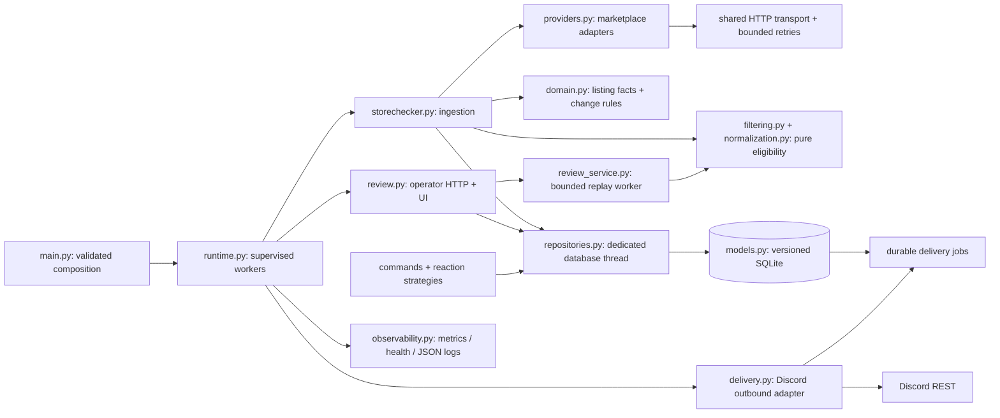
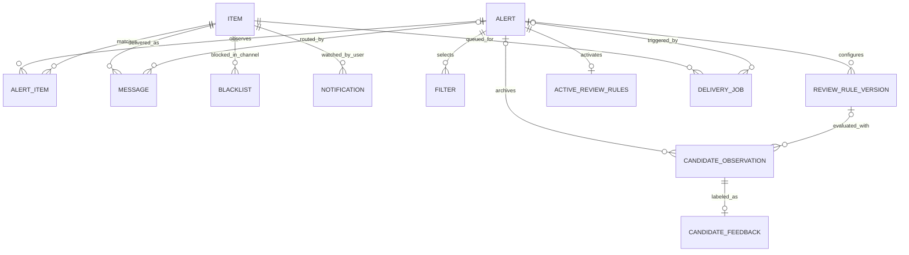

# Application architecture

The bot remains one Python 3.11 process with SQLite persistence. Marketplace search, notification policy, storage, Discord delivery, and supervision now have explicit boundaries. The [original architecture review](architecture-before-refactor.md) records the implementation before these changes; its source line references refer to the reviewed commit, not the refactored files.



## Runtime and boundaries

| Module | Responsibility |
| --- | --- |
| `config.py` | Validates environment values; consistent 1,800-second default interval; token hidden from representations |
| `main.py` | Loads dotenv before database initialization, explicitly registers commands, owns Discord lifecycle listeners |
| `runtime.py` | Retains and supervises polling, delivery, event-loop monitoring, and database-stat tasks |
| `providers.py` | HTTP session lifetime, safe query parameters, transient retries, pagination and marketplace normalization |
| `yahoo.py`, `mercari.py`, `surugaya.py` | Compatibility exports for provider classes; no Discord or database dependencies |
| `domain.py` | Immutable listing facts, change rules, and compatibility matching for existing Discord filters |
| `normalization.py` | Versioned Unicode title normalization; original titles remain intact |
| `filtering.py` | Validated grouped rules, legacy compatibility, bounded regex evaluation and explainable decisions |
| `storechecker.py` | Applies eligibility rules, archives candidates and coordinates observations; malformed items do not prevent valid siblings from being stored |
| `models.py` | Schema v4, explicit database binding and transactional migrations with backups |
| `repositories.py` | Async persistence API over a single database thread; no Peewee objects escape to callers |
| `review_repository.py` | Candidate snapshots, feedback, immutable rule versions, atomic activation and retention on the same database executor |
| `review_service.py` | Stateless previews and bounded historical replay on a separate CPU worker |
| `review.py` | Authenticated same-origin operator API that also serves the built UI; separate listener from monitoring |
| `frontend/` | Filter Lab's React, MUI and TypeScript UI; the Docker image ships only its build in `frontend/dist` |
| `delivery.py` | Formats embeds and sends durable channel/DM jobs with independent retries |
| `observability.py` | Bounded-label Prometheus collectors, JSON correlation/redaction, health endpoints |
| `commands/*` | Thin Discord command adapters using repository methods and guild/channel checks |
| `processors/*`, `handlers/*`, `strategies/*` | Reaction routing and idempotent channel blacklist/listing subscription operations |
| `manage.py` | Inspect failed delivery jobs and requeue them after fixing their cause |
| `healthcheck.py` | Container readiness probe independent of token/SDK imports |

Resources open during startup; polling begins only after Discord's `StartedEvent`. Gateway disconnection changes readiness without killing durable state. Worker crashes mark readiness false and shut down the bot with a nonzero exit. Shutdown cancels and settles child tasks before closing the review listener and replay worker, HTTP, monitoring, and the database executor.

Discord uses stable Hikari 2.6.0 and Lightbulb 3.2.6. `ApplicationBot` owns the Hikari
gateway and an explicit `ApplicationServices` container; the separate Lightbulb
client registers class-based slash commands and supplies their repository and
Discord dependencies through its native dependency injection. Runtime permission
hooks enforce guild and Manage Channels checks in addition to Discord command
visibility. Lightbulb synchronizes commands before polling workers start; command
sync failure follows the same supervised startup failure path. Shutdown stops the
command client and its pagination resources before closing the repository. The
gateway subscribes only to guild and guild-reaction intents.

Polling creates only `CHECK_CONCURRENCY` check-worker tasks and lazily assigns alert/source jobs. Each check has a deadline. All workers settle before the next cycle; errors are isolated and counted rather than allowing sibling tasks to survive into a later batch. Cycle duration still includes work, followed by `CHECK_INTERVAL` sleep.

HTTP and Discord delivery have separate scheduling. Database work and its queue wait are measured outside the event-loop thread. Provider instances and their connection pool live for the runtime lifetime. Pagination yields a page at a time and explicitly reports searches exceeding `MAX_SEARCH_PAGES`, malformed responses, or incomplete pagination.

Every search page refreshes the result `count` and page total, because listings end or appear during long scans. Yahoo and Surugaya report an exact `count`, so a scan fails as incomplete if it delivers fewer items than the latest one. FromJapan's Mercari `count` is only an estimate and its pages are short, so Mercari scans end at the first empty page. `MAX_SEARCH_PAGES` caps both.

Surugaya listings take their title and canonical product URL (`/product/detail/` or `/product/other/`) from the FromJapan search response, like the other marketplaces. suruga-ya.jp answers automated product-page requests with a Cloudflare challenge, so the bot never fetches product HTML.

## Data model and notification semantics



- Alerts are unique by `(channel_id, search_query)`. The same query can be used in multiple channels. Guild ownership is stored for new alerts and reconciled for legacy rows using known cached channel ownership.
- Listings are unique by `(checker/source, external item_id)`, preventing cross-marketplace collisions.
- `AlertItem` records each matching alert's stock/price baseline. One query cannot consume another query's change notification.
- `Message` retains every acknowledged channel message, including old updates, for reaction lookup. Deleting a message marks that record rather than deleting the listing.
- Blacklists are unique per listing/channel. Bell subscriptions are unique per listing/user and listing-wide, preserving their prior intended scope.
- Observing a listing and creating its delivery jobs happen in one SQLite transaction. The baseline advances only when its delivery intentions are durably recorded.
- Subscriber DMs use listing-wide changes, avoiding duplicate DMs when several alerts observe the same change. Channel updates use each alert's baseline.
- Muted listings retain observations but queue neither updates nor DMs. There is no new mute command.
- `last_seen_at` records observation; `updated_at` advances when listing facts change. Prices, URLs, images, and end times can be reconstructed from persisted listing facts and immutable job payloads.

Existing notification thresholds are preserved deliberately: price decreases strictly greater than `PRICE_CHANGE_THRESHOLD` (default ¥500); buyout changes in either direction strictly greater than that threshold; stock changes only when the new quantity exceeds 1. Silent changes advance the consecutive-observation baseline. Listing disappearance still does not imply sold/ended: search omissions are not reliable evidence for such an event.

Enabled title filters actually participate in ingestion. Blacklist matches veto a listing; if any whitelist rules exist, at least one must match. Text matching remains case-sensitive. Regex is compiled once per check, validated on creation, and limited to 256 characters. Matching runs off the event loop with a 50-millisecond deadline per pattern; an evaluation timeout logs the rule version, counts the failure, and archives the item for review without stopping valid siblings. The saved decision identifies the legacy filter or new rule group involved. This uses the [regex engine's timeout support](https://pypi.org/project/regex/2024.11.6/). Alerts allow at most 50 filters. Match counters are aggregated and persisted once per check. A filtered listing does not advance its baseline or queue delivery.

Filter Lab adds versioned grouped rules on top of this compatibility path. The
same pure evaluator runs during ingestion, title preview, and replay. Required
groups combine with AND, with any/all matching inside each group; exclusion
groups veto matches and review groups suppress ambiguous listings. Rules can
limit source and price. Each profile controls Unicode normalization and whether
existing Discord filters participate. No product-specific exclusions are enabled
automatically. Missing or unknown titles require review.

Every candidate is archived before it can be discarded, including invalid
provider facts and channel blacklists. Accepted
candidate history, listing facts, per-alert baselines and outbox intentions
commit together. Rejected candidates create only archive records. Snapshots
retain original titles, normalized titles, decision reasons, normalization
version, rule-version ID and alert/channel identity. A listing seen again with
the same decision refreshes its row and last-seen time instead of adding a copy;
a new decision adds a row and keeps the listing's label. Unregistering an alert
detaches its history instead of deleting it; reusing a SQLite ID does not attach
old history to a different alert.

Rule versions are immutable. Publishing uses a compare-and-swap check against
the active version; restoring copies the selected version into a new version.
Checks capture the active profile at their start, so a publication takes effect
on subsequent checks. Preview and replay have no ingestion or delivery side
effects. Replay uses one separate worker, the latest decision of at most 500
recently seen listings plus up to 1,000 labeled ones, and a 10-second
processing budget; incomplete listing snapshots stay in review. It
compares title/source/price eligibility while retaining recorded channel
blacklist vetoes. It does not reconstruct delivery, changing blacklist state,
subscriptions or stock-change behavior. Feedback supports relevant, wrong
product, accessory, bundle and unsure labels. See [filter-lab.md](filter-lab.md).

## Durable delivery and recovery

Each channel post and subscriber DM is a separate `DeliveryJob`. Discord failures do not roll back the observed marketplace state or block later jobs. Transient failures use bounded exponential delays; permission, missing-resource, malformed-payload failures, and exhausted attempts become `failed` jobs visible in metrics and operational commands.

A channel message's ID and historical mapping are saved immediately after creation and before adding reactions. If a reaction fails, the next attempt reuses that message. A failed DM cannot prevent the channel job from completing. Blacklisting, unsubscribing, and unregistering cancel matching pending jobs. An already in-flight Discord request cannot be guaranteed to stop when configuration changes.

There remains an unavoidable ambiguity if Discord accepts a message and the process dies before its acknowledgment reaches SQLite. This is an at-least-once retry system, not an exactly-once delivery guarantee. An operator may need to reconcile a duplicate after that narrow failure window. The application has one delivery worker and assumes one process per database; do not run multiple replicas against this file without adding job leases.

After fixing a failed job's cause:

```bash
python manage.py --database alerts.db outbox-list --status failed
python manage.py --database alerts.db outbox-retry --id 123
```

Retries preserve acknowledged message IDs. The CLI never migrates or creates a missing database. Sent job payloads and message history currently have no automatic retention policy; measure database growth before choosing retention, and keep reaction mappings for as long as historical reactions must work.

## Migration and compatibility

Startup migrates the original five-table schema to schema v4. The original
conversion and the migrations from schema v2 and v3 create an online SQLite
backup named `alerts.db.pre-v4.<UTC timestamp>.bak`, with the database file's
own permissions, before changing tables. Schema changes and data conversion
are transactional, foreign keys are validated, and startup refuses unknown
versioned schemas. The v2 migration adds review tables without changing existing
listing, baseline or delivery data. The v3 migration adds `last_seen_at`, indexes
candidates by alert and listing, and folds the repeated copies earlier polls
saved into one row per decision; each kept row takes the newest label of the
rows it replaces. On the dev database this removed 38,896 of 50,000 rows in
about a second.

Known checker class names map to stable marketplace keys. IDs, mute state, subscriptions, blacklists, and the latest available message mapping are preserved. Duplicate subscriptions/blacklists are collapsed. Orphaned child rows are counted in the migration log and remain in the backup. Listings with unknown sources are retained under their legacy source and reported for manual mapping.

Old filters saved blacklist/whitelist policy but lost the selected text/regex method. Those rows are preserved with `method=legacy`, disabled, and exposed through `/filters get` and `auction_bot_disabled_legacy_filters`. Delete and recreate them with an explicit matcher. No reliable migration can infer their original intent.

Overwritten alert associations and older message IDs were absent from the old database and cannot be recovered automatically. The migration preserves what is present, then discovers additional alert/listing associations in future checks. Legacy guild IDs are backfilled from known Discord channel IDs, not guessed from search query text.

Re-registration and filter management are channel scoped. Mutating commands and `/allalerts` require the guild's Manage Channels permission. `/allalerts` lists the current guild and includes current-channel legacy rows. Cleanup requests are bounded to 1 to 100 deletes over the latest 1,000 messages; historical reaction backfill visits only tracked listing posts. Subscription confirmation DMs are best-effort and do not undo the saved subscription when DMs are unavailable.

## Monitoring and validation

See [monitoring.md](monitoring.md) for metric names, health semantics, Prometheus configuration, alert rules, and suggested dashboard panels. Telemetry is placed at runtime, transport, repository, and delivery boundaries so domain policy remains deterministic and provider code remains independent of Discord.

Per-alert check metrics carry `alert_id`. The `auction_bot_alert_info` metadata series maps it to the query and channel so Grafana can join in friendly names without repeating query text on every counter and histogram. Metadata refreshes between polls; removed alerts retire their live collectors. Global metrics retain their original label sets.

Tests use temporary databases, fake Discord REST, and temporary local HTTP servers. They cover migrations/backups, identity and alert isolation, filters, delivery failure windows, HTTP retries/pagination, command permissions, reactions, bounded scheduling, cancellation, metrics, readiness, and token redaction. GitHub Actions runs Ruff, pytest and the UI's lint, type check, tests and build before building or deploying.

The runtime dependency list now includes only directly used libraries, and Docker caches dependency installation before copying source. A Node stage builds the UI, and the runtime image receives only the built files. A `.dockerignore` excludes credentials, databases, backups, virtual environments, and caches. The deployment mounts the entire database directory so migration backups survive container replacement, uses an explicit database path, and configures restart behavior and a container readiness probe.
