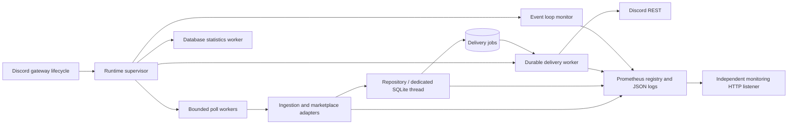

# Monitoring and runtime operations

The bot remains one deployed process. Runtime scheduling, ingestion, persistence, Discord delivery and observability have separate responsibilities. Metrics and logs instrument those boundaries; they do not control listing or delivery policy.



[main.py](../main.py) assembles components through `create_application()`. Dotenv and validated settings are loaded before SQLite is bound and migrated. Importing the module does not require a token, construct a bot or access a database. Commands are explicitly registered by qualified module import. Shared provider instances retain their caches and use one HTTP session.

[runtime.py](../runtime.py) opens the repository, HTTP client and monitoring listener during `StartingEvent`. Background workers start once at `StartedEvent`, after gateway startup completes. Polling creates at most `CHECK_CONCURRENCY` worker tasks and applies `CHECK_TIMEOUT` to each complete alert/source check. Each cycle settles every check before waiting `CHECK_INTERVAL`; failures cannot leave checks running into the next cycle. Canceling the poller also cancels and joins its workers. Recoverable cycle/database errors are logged and retried on subsequent cycles. Unexpected worker death marks readiness false, logs `worker_stopped`, closes the bot and results in a nonzero process exit. Shutdown cancels and joins workers before closing owned resources.

## Endpoints and configuration

The HTTP listener defaults to `127.0.0.1:9100`, independent of Discord gateway connectivity. Set the bind address deliberately when Prometheus runs outside the bot's host/network namespace.

| Endpoint | Behavior |
| --- | --- |
| `GET /metrics` | Prometheus text exposition, HTTP 200 while the listener is running, including when the bot is unready |
| `GET /health/live` | HTTP 200 while the process is serving; HTTP 503 during shutdown |
| `GET /health/ready` | HTTP 200 when gateway shards are connected, workers are alive, database statistics are fresh and polling is recent; otherwise HTTP 503 with JSON explaining those states |

Readiness considers every shard hosted by this process. Before workers start, readiness is false. The poll freshness grace period begins when workers start. Database readiness requires a successful statistics read and becomes false if that read fails or the last successful refresh is older than `max(30, 3 * METRICS_STATS_INTERVAL)` seconds. Marketplace failures remain visible through failed checks and success timestamps; they do not automatically restart a healthy process.

| Variable | Default | Purpose |
| --- | --- | --- |
| `MONITORING_ENABLED` | `true` | Enable the HTTP listener; instrumentation and structured logs still run if it is disabled |
| `MONITORING_HOST` | `127.0.0.1` | HTTP bind address |
| `MONITORING_PORT` | `9100` | HTTP port |
| `METRICS_STATS_INTERVAL` | `10` | Seconds between repository/outbox statistics snapshots |
| `HEALTH_MAX_POLL_AGE` | `CHECK_INTERVAL + CHECK_TIMEOUT + 60` | Maximum seconds since a completed poll cycle, including partial failures |
| `LOG_LEVEL` | `INFO` | JSON log verbosity; accepted values are standard Python log levels |
| `CHECK_INTERVAL` | `1800` | Delay after all checks in a cycle settle |
| `CHECK_CONCURRENCY` | `4` | Maximum concurrent alert/source checks, validated between 1 and 32 |
| `CHECK_TIMEOUT` | `600` | Deadline for a complete alert/source check |
| `REQUEST_TIMEOUT` | `30` | Individual marketplace HTTP attempt timeout |
| `REQUEST_RETRIES` | `2` | Extra attempts for transient request errors |
| `DELIVERY_MAX_ATTEMPTS` | `8` | Maximum attempts before a delivery job becomes terminal |
| `PROMETHEUS_URL` | empty | The Prometheus that scrapes the bot, such as `http://prometheus:9090`, for the graphs on the dashboard's Status page; empty turns them off |
| `PROMETHEUS_INSTANCE` | empty | This bot's `instance` label in that Prometheus, needed when more than one bot reports under the `auction-bot` job |

`HEALTH_MAX_POLL_AGE` must cover the interval plus the normal duration of an entire cycle, which can exceed a single check timeout when there are many alerts. Use observed poll latency and alert count to choose it. The supplied alert rules read the configured thresholds from metrics rather than assuming a fixed polling interval.

For a local bot and Prometheus on the same host:

```sh
curl -fsS http://127.0.0.1:9100/metrics
curl -i http://127.0.0.1:9100/health/ready
promtool check config monitoring/prometheus.yml
promtool check rules monitoring/alerts.yml
promtool test rules monitoring/alerts.test.yml
prometheus --config.file=monitoring/prometheus.yml
```

[monitoring/prometheus.yml](../monitoring/prometheus.yml) scrapes every 15 seconds and loads [monitoring/alerts.yml](../monitoring/alerts.yml). Update its target when deploying on separate hosts or a private container network. For a container with Prometheus on its host, set `MONITORING_HOST=0.0.0.0` inside the container and publish `127.0.0.1:9100:9100`. For Prometheus in another container, use a private shared network and its service address instead of the loopback target. The sample collects metrics and evaluates rules; notification delivery requires your Prometheus/Alertmanager integration.

[monitoring/alerts.test.yml](../monitoring/alerts.test.yml) verifies source freshness independently of completed-cycle heartbeats, suppresses source alerts when no searches are configured and checks first-cycle startup grace. The supplied configuration, all ten rules and these scenarios were validated with Prometheus's `promtool` 3.15.0.

## Metrics and logs

All application metrics use the `auction_bot_` prefix. Durations use seconds, counters end in `_total`, and event times are Unix timestamp gauges. This follows the [Prometheus naming guidance](https://prometheus.io/docs/practices/naming/). Global metrics describe bounded categories such as source, operation, outcome, delivery kind and worker. Dedicated per-alert check metrics add `alert_id`; a single metadata series per configured alert maps that ID to its query and channel. Query text is kept off counters and histograms. Listing, guild, message and user IDs remain in logs. Removed alerts stop exporting their metadata and per-alert metrics. Separate completion and success timestamps make a failed-but-running pipeline visible, following [Prometheus instrumentation guidance](https://prometheus.io/docs/practices/instrumentation/).

| Boundary | Metrics |
| --- | --- |
| Scheduling | `polls_total{outcome}`, `poll_duration_seconds`, `last_poll_completed_timestamp_seconds`, `last_poll_success_timestamp_seconds`, `source_last_success_timestamp_seconds{source}`, `checks_total{source,outcome}`, `check_duration_seconds{source}`, `active_checks` |
| Per-alert scheduling | `alert_checks_total{alert_id,source,outcome}`, `alert_check_duration_seconds{alert_id,source}` |
| Alert metadata | `alert_info{alert_id,search_query,channel_id}` with value 1; refreshed each poll and database-stat snapshot |
| Provider transport | `provider_requests_total{source,operation,outcome}`, `provider_request_duration_seconds{source,operation}` |
| Ingestion decisions | `items_total{source,outcome}`; includes filtered, blacklisted and invalid decisions as well as recorded observations |
| SQLite | `database_operation_duration_seconds{operation}` including executor queue wait, `database_errors_total{operation}`, `database_stats_refreshed_timestamp_seconds` |
| Delivery | `delivery_attempts_total{kind,outcome}`, `delivery_duration_seconds{kind}`, `outbox_pending`, `outbox_failed`, `outbox_oldest_pending_age_seconds` |
| Runtime health | `worker_alive{worker}`, `discord_connected`, `ready`, `event_loop_lag_seconds`, `started_timestamp_seconds` |
| Configuration | `configured_alerts`, `disabled_legacy_filters`, `configured_poll_interval_seconds`, `configured_stats_interval_seconds`, `health_max_poll_age_seconds` |
| Discord interactions | `reaction_errors_total`, `command_errors_total{outcome}` |
| Dashboard | `dashboard_requests_total{operation,outcome}`, `dashboard_request_duration_seconds{operation}`, `dashboard_logins_total{method,outcome}`, `dashboard_access_checks_total{outcome}` |

Histogram names also expose `_bucket`, `_count` and `_sum`. Standard Python GC/platform collectors and process metrics are included; process metrics depend on platform support. Each application uses its own registry so tests and application instances do not duplicate global metric registration.

`last_poll_completed_timestamp_seconds` advances after a settled cycle even when some checks fail, or when a recoverable cycle read fails. `last_poll_success_timestamp_seconds` advances only when the cycle has no failed checks. Per-source success advances only when that source has at least one check and all its checks succeed in that cycle. No alerts is a successful empty cycle; it does not mark source checks as successful. Cancelled cycles do not count as completed cycles. Health freshness uses a monotonic clock; exported event timestamps use wall time.

A source that no search checks, such as one that every search turned off, exports no `source_last_success_timestamp_seconds` series, so `AuctionBotSourceStale` cannot fire for it. When a search checks it again, its age counts from the start of that cycle.

Provider counters count request attempts, including retries. Delivery counters count attempts rather than unique listings or messages. A successful ingestion check means listings were observed and delivery jobs were durably queued; delivery success is tracked independently. Queue gauges are periodic database snapshots. A zero queue gauge with a stale statistics timestamp is not evidence that delivery is healthy. Post removals that the dashboard queues count in `delivery_attempts_total{kind="delete"}` but not in the three outbox gauges: a long cleanup is expected to take a while and should not set off the backlog or failure alerts. The dashboard shows their progress, and `manage.py outbox-list` lists them with the other jobs.

The dashboard request labels use fixed API operation names and outcomes. Candidate
IDs, rule text, access keys, Discord user IDs and search queries do not become
metric labels. `dashboard_logins_total` counts sign-ins by method (`discord` or
`access_key`) and result: `success`, or why it was refused (`cancelled`,
`state`, `not_member`, `missing_permission`, `discord_error`,
`discord_unavailable`, `rate_limited`, `cookie`, `wrong_key`).
`dashboard_access_checks_total` counts the repeated checks of signed-in people:
`kept`, `reduced` (lost some servers), `revoked` (lost all, signed out) and
`error` (Discord did not answer). A rise in `error` means people are being
refused while Discord is unreachable.
Ingestion item outcomes now also include `filtered`, `review`, `blacklisted`,
`invalid`, `filter_timeout` and `seeded`: a listing saved without a post by a
marketplace's first check for a search. Database operation timing
covers candidate writes, publication, post removals and history retention through
the existing repository boundary. The standalone dashboard does not expose a
Prometheus listener; the embedded bot mode uses the normal monitoring registry.

JSON logs include `timestamp`, `level`, `logger` and `event`, with contextual fields. Poll checks carry `cycle_id`, `alert_id` and `source`; delivery attempts carry `delivery_id` and `kind`. Context is local to the asyncio task and is restored after the operation. Exceptions retain their traceback. The configured bot token is redacted from messages, fields and tracebacks, and known secret field keys are redacted recursively. HTTP access logs are disabled. Keep logs in the process's stdout/stderr collection pipeline; no external logging service is required by the app.

Example event:

```json
{"timestamp":"2026-10-03T00:00:00+00:00","level":"INFO","logger":"runtime","event":"poll_completed","cycle_id":"example","outcome":"partial","alerts":4,"checks":12,"failed_checks":1,"duration_seconds":8.7}
```

## Finding alert names in Grafana

The lookup metric contains one series per configured alert:

```text
auction_bot_alert_info{alert_id="17",search_query="BABYMETAL",channel_id="123"} 1
```

Metadata is refreshed every `METRICS_STATS_INTERVAL` seconds (default 10), including between poll cycles. Per-alert check counters and histograms carry the ID, not the query text. Existing global metric names and label sets remain available for aggregate dashboards and alert rules.

A PromQL join attaches the friendly query and channel to each alert's check counts:

```promql
auction_bot_alert_checks_total{job="auction-bot"}
  * on (job, instance, alert_id) group_left(search_query, channel_id)
    auction_bot_alert_info{job="auction-bot"}
```

The metadata value is 1, so multiplication keeps each check count unchanged and adds the lookup labels. The join includes `job` and `instance` because separate databases can contain the same numeric alert ID. This uses [Prometheus vector matching](https://prometheus.io/docs/prometheus/latest/querying/operators/).

For a time-series panel, set its legend to `{{search_query}} — {{source}} — {{outcome}}`. For a table, use the joined expression as an instant query and show `search_query`, `channel_id`, `source`, `outcome`, and value. Grafana also supports two instant table queries combined with a [Join by field transformation](https://grafana.com/docs/grafana/latest/visualizations/panels-visualizations/query-transform-data/transform-data/); scope both to one instance before joining just on `alert_id`.

To select an alert, use a Grafana Prometheus query variable with query type **Label values**, metric `auction_bot_alert_info`, and label `alert_id`. A neighboring metadata table can show the selected query, or use a **Query result** variable over `auction_bot_alert_info` and named text/value captures to present a friendly name while retaining the ID as the value. Grafana documents these [variable query types](https://grafana.com/docs/grafana/latest/datasources/prometheus/template-variables/). Filter the check panels with `alert_id=~"$alert_id"` and scope the dashboard to its chosen instance.

Deleted alerts are removed from the current lookup, and an ID reused with a different query/channel resets its live per-alert collectors. Prometheus retains already-scraped samples according to its retention setting; inspect historical timestamps to join metadata for an alert that was active then. Use global metrics for long-term totals across retired alerts, since joining against the current lookup selects only currently configured alerts.

[monitoring/grafana.test.yml](../monitoring/grafana.test.yml) tests that metadata joins preserve counts, attach the correct name/channel across two instances sharing an ID, and omit an alert absent from the current lookup:

```sh
promtool test rules monitoring/grafana.test.yml
```

## Dashboards and alert response

[monitoring/grafana-dashboard.json](../monitoring/grafana-dashboard.json) is a ready-made Grafana dashboard (uid `auction-bot`) for the `auction-bot` scrape job. It covers health, polling, per-search checks, marketplace requests, Discord delivery, runtime and Loki logs (by `container` label). Import it and choose the Prometheus and Loki data sources; the `instance` variable selects bot instances.

Every panel has a description, shown by the ⓘ next to its title, that says in plain words what the graph shows and what to look for. A new or changed panel needs one too; a test checks that none is missing.

Useful initial dashboard queries:

```promql
# Poll duration p95, per instance
histogram_quantile(0.95, sum by (instance, le) (rate(auction_bot_poll_duration_seconds_bucket[6h])))

# Checks failing or timing out, per source
sum by (source) (rate(auction_bot_checks_total{outcome=~"error|timeout"}[1h]))

# HTTP request latency p95 by source and operation
histogram_quantile(0.95, sum by (source, operation, le) (rate(auction_bot_provider_request_duration_seconds_bucket[1h])))

# Current delivery backlog and its oldest age
auction_bot_outbox_pending
auction_bot_outbox_oldest_pending_age_seconds

# SQL operation latency, including executor queue wait
histogram_quantile(0.95, sum by (operation, le) (rate(auction_bot_database_operation_duration_seconds_bucket[1h])))
```

The supplied alerts cover unavailable scraping, readiness, dead workers, stale cycles and sources, aging/failed deliveries, stale queue statistics, event loop lag and disabled legacy filters. They are starting thresholds for this bot's default cadence; tune latency/backlog tolerances against observed workload. Provider request failures alone are less actionable than sustained source failure because transient failures can recover within the same check.

For a delivery incident, correlate `delivery_id` with `delivery_job.id` and inspect `status`, `attempts`, `last_error` and `message_id`. Permission errors, unavailable destinations and invalid payloads can become terminal before the attempt limit. After resolving the cause, use [manage.py](../manage.py) to inspect failed jobs and retry a selected job:

```sh
python manage.py --database alerts.db outbox-list --status failed
python manage.py --database alerts.db outbox-retry --id 42
```

The retry operation resets the attempt count and retains an acknowledged `message_id`. That prevents re-posting when only reactions failed; a process crash between Discord accepting a message and saving its acknowledgment can still produce a duplicate on retry. Metrics measure that pipeline but do not remove this external-system crash window.

For legacy filter alerts, open the search in the dashboard: the Rules tab lists its Discord filters, including the disabled ones. Add each term you want to keep to a rule group, then delete the old filter there or with `/filters delete`. The old database never saved whether a filter was text or a regex, so migration cannot infer it safely.

Tune concurrency after watching request/check latency, provider error rates, SQLite queue latency, event loop lag and outbox age together. Increasing ingestion parallelism can increase provider throttling and enqueue deliveries faster than Discord can accept them. Separate workers make that bottleneck visible and allow later changes to delivery concurrency without changing marketplace adapters.

## The same graphs on the dashboard's Status page

The dashboard's Status page (see [dashboard.md](dashboard.md#status)) shows the main panels of this Grafana dashboard, each with its description behind a **?**. They are not copied: at startup the dashboard reads each panel's title, description, unit, drawing style and PromQL from `monitoring/grafana-dashboard.json`, and it runs those queries against `PROMETHEUS_URL` with `$instance`, `$__rate_interval`, `$__interval` and `$__range` filled in the way Grafana fills them. Grafana's rows become the page's headings. To change a graph, change it in Grafana, export the dashboard as JSON into that file (keep the data sources as the dashboard's `prometheus` and `loki` variables), and restart. `PANELS` in `dashboard_graphs.py` lists the panels the Status page shows. Startup stops with a message when one of them is missing, is not a time series or a table, or uses another variable, so a dashboard change cannot quietly break the page.

The browser only talks to the dashboard, and the dashboard asks Prometheus, so Prometheus needs no public address. The browser picks a range (1 hour, 6 hours, 24 hours or 7 days) and never sends PromQL. The answers are shared by everyone for 30 seconds. Most graphs count the whole bot. A panel whose query keeps `alert_id` is about single searches: each server only sees the series of its own searches, and only those whose search text and channel match the search as it is now, so a reused alert ID does not show a deleted search's history. When Prometheus has more than one bot under the `auction-bot` job and `PROMETHEUS_INSTANCE` is not set, the Status page says so and leaves the per-search graphs out, because an alert ID does not say which bot it belongs to.

Embedding Grafana instead would not fit. An embedded panel needs `allow_embedding` and either anonymous access or a separate Grafana sign-in, and the dashboard's content security policy only allows frames and requests from the dashboard itself. Public dashboards take no variables, so they cannot be limited to one server, and anyone with the link sees every search. [Grafana Scenes](https://grafana.com/developers/scenes) only runs inside a Grafana app plugin, and the [Foundation SDK](https://github.com/grafana/grafana-foundation-sdk) writes dashboards as code but does not draw them. Reading the exported JSON keeps one definition of each graph for both.
